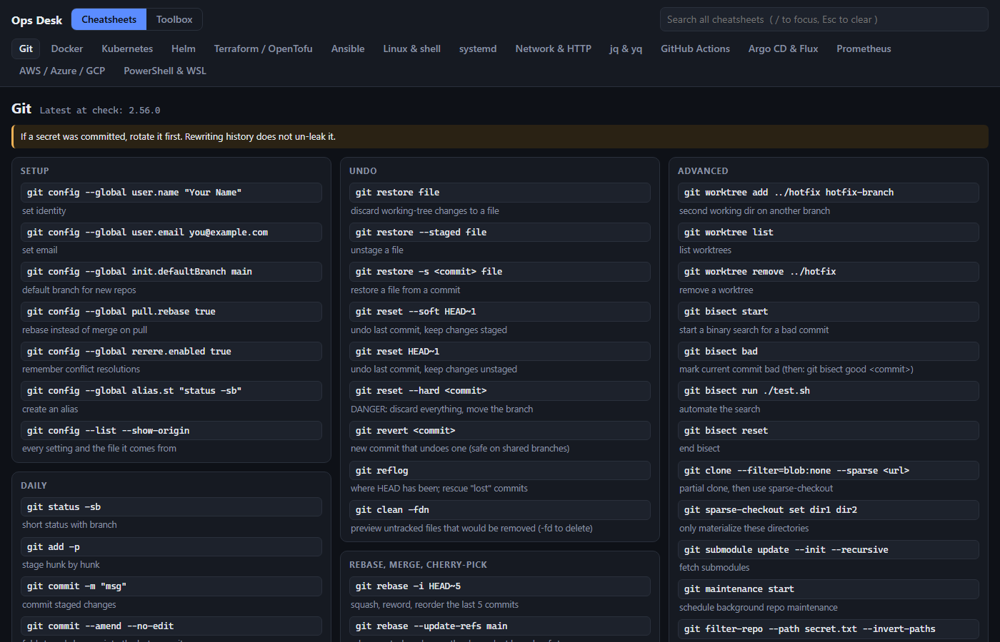

# devops-toolbox

Small, self-contained tools for day-to-day DevOps work.

| Tool | Description |
|---|---|
| [daily-dashboard](daily-dashboard/) ([▶ live](https://underscorelog.github.io/devops-toolbox/daily-dashboard/)) | **Ops Desk**: offline single-file HTML with searchable cheatsheets (Git, Docker, Kubernetes, Helm, Terraform, Ansible, cloud CLIs...) and a toolbox of converters (JWT, CIDR, cron, epoch, hash, regex...). |

**[▶ Open Ops Desk live](https://underscorelog.github.io/devops-toolbox/daily-dashboard/)**

