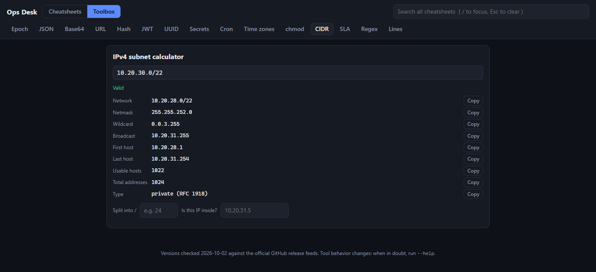

# Ops Desk (daily-dashboard)

A single-file, offline DevOps desk: searchable cheatsheets for the tools used every day, plus a toolbox of small converters and calculators. One `index.html`, no build step, no dependencies, no network calls.




## Usage

Open `index.html` in any modern browser. That's it.

```bash
# or serve it, e.g. to share on a LAN
python -m http.server 8080
```

- `/` focuses the search, `Esc` clears it. Search runs across every cheatsheet at once.
- Click a command to copy it.
- The last mode and tabs you used are remembered in `localStorage` (keys prefixed `od.`). Nothing else is stored, nothing leaves the browser.
- Follows the OS light/dark preference ([light screenshot](screenshots/cheatsheets-light.png)).

## Cheatsheets

Git, Docker, Kubernetes, Helm, Terraform / OpenTofu, Ansible, Linux & shell, systemd, Network & HTTP, jq & yq, GitHub Actions, Argo CD & Flux, Prometheus, AWS / Azure / GCP, PowerShell & WSL.

Each sheet is grouped by task (setup, daily, undo, debugging...) with a one-line explanation per command and warnings where a command is destructive. Most sheets show the latest release version at the time of writing (checked 2026-10-02 against the official GitHub release feeds), so flags may drift: when in doubt, run `--help`.

## Toolbox

| Tool | What it does |
|---|---|
| Epoch | Unix timestamp to/from human dates |
| JSON | Format, minify and validate |
| Base64 | Encode / decode |
| URL | Encode / decode / parse into parts |
| Hash | SHA-1 / 256 / 384 / 512 via Web Crypto |
| JWT | Decode header and payload (no signature check) |
| UUID | v4 generator |
| Secrets | Random secret generator (`crypto.getRandomValues`) |
| Cron | Check a cron expression and show the next 6 runs |
| Time zones | Convert a time across zones |
| chmod | Octal / symbolic permission calculator |
| CIDR | IPv4 subnet calculator, split, "is this IP inside?" |
| SLA | Availability % to allowed downtime |
| Regex | Tester (JavaScript flavor) |
| Lines | Sort (text or numeric), dedupe, reverse, trim |

Everything runs client-side, so it is safe to paste tokens or internal hostnames into the JWT, hash or CIDR tools.

## Editing a cheatsheet

Sheets live as plain-text blocks inside `index.html` (`<script type="text/plain" id="cs-...">`). Format:

```text
@ver Latest at check: 1.2.3
! warning banner
# Section title
command ## description (click to copy)
~ label ## description (note row, not copyable)
```

Add a new `<script type="text/plain" id="cs-xyz" data-name="Name">` block and it shows up as a tab.
